# RetroAgent: run-to-run variance, regime-dependent behaviour and memory effects in an LLM trading agent

**Elias Chawki** · October 2026 · Working paper (research log, not peer reviewed)

> **TL;DR.** I replayed 186 historical trading sessions through an LLM agent with tools and a persistent knowledge base. Three things stood out. (1) Two runs with *identical* model, prompt, memory and market data ended April 2025 **$20,536 apart** (−$10,800 vs +$9,736 on a $100K account), even though their daily results were strongly correlated (r = 0.76); the divergence concentrated on the most extreme market days. (2) The agent's behaviour shifted with the volatility regime: the share of new positions that lose if the market keeps falling (put credit spreads) rose with VIX (r = 0.44, 95% CI 0.30 to 0.60, n = 101 sessions), and on gap-down days from 37% in January to 68% in April. (3) Runs that started with an empty memory outperformed runs with accumulated memory in 3 of 5 months, but **no single month's result is statistically distinguishable from zero**, and the comparison is confounded. The practical lesson for agent evaluation: single runs are not evidence, and the variance is largest exactly where safety matters most, out of distribution.

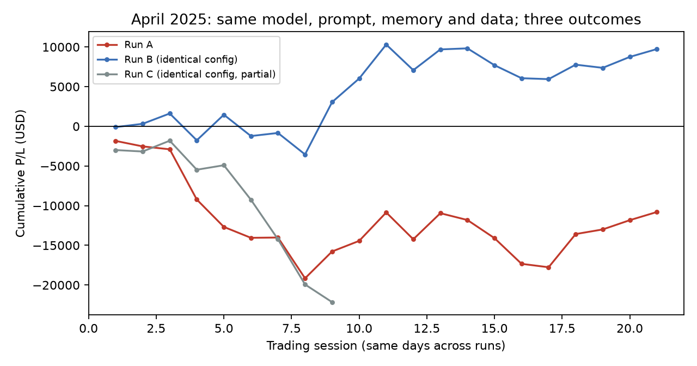

*Figure 3 (lead). Cumulative P/L of three April 2025 runs with identical model, prompt hash, starting memory and market data.*

---

## 1. Why this matters beyond trading

Agents are increasingly evaluated by running them once on a task suite and reading off a score. Trading is a useful stress test for that practice because the environment is adversarial, the feedback is numeric, and the data can be replayed exactly. Three questions from this setting transfer directly to agent safety and evaluation:

1. **How much of an agent's measured performance is the agent, and how much is sampling noise?** If identical configurations produce opposite outcomes, a single evaluation run cannot rank agents, prompts or safety interventions.
2. **Does behaviour learned in one regime transfer badly to another?** An agent that accumulates experience under calm conditions may act confidently on it under conditions it has never seen: a concrete, measurable instance of distribution shift.
3. **Does persistent memory help or hurt?** Long-running agents with memory are becoming the default. Whether memory improves behaviour, or entrenches patterns that stop being true, is an open empirical question.

## 2. Setup

**Environment.** A replay harness over historical 0DTE SPX options data (January to August 2025). Each *session* is one real trading day replayed from stored market data; the agent cannot see the future and every run sees byte-identical inputs. The underlying simulation engine is a private third-party options replay engine (see [Credits](#credits)); the agent layer, RetroAgent, is what this paper studies.

**Figure A. System architecture.**

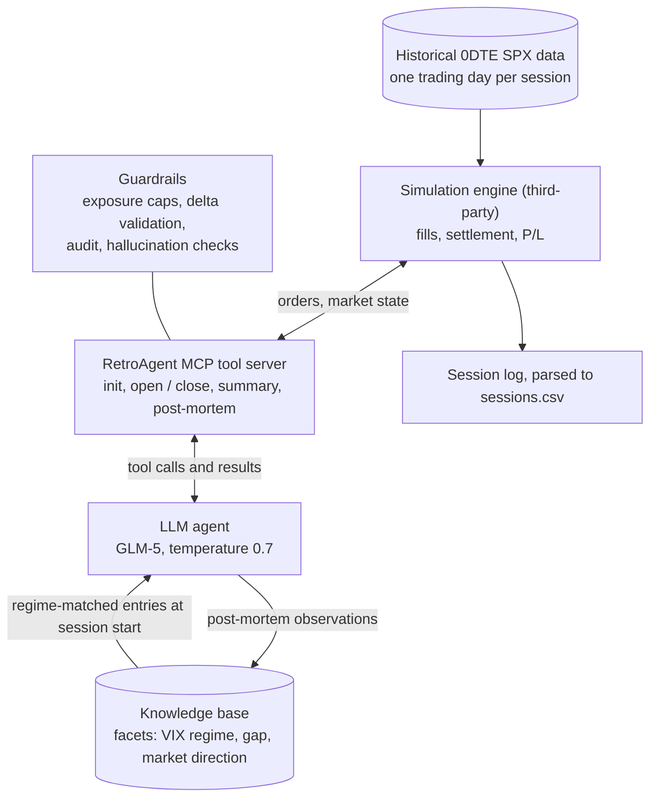


**Agent.** A tool-using LLM agent (GLM-5 via the z.ai API, temperature 0.7) driven through an MCP tool server. Per session it receives market context (weekday, VIX level and regime, overnight gap direction, intraday candles), opens and manages credit-spread positions through tools, and writes a post-mortem. Sessions average 31 to 40 agent turns.

**Memory.** A persistent knowledge base (KB). After each session the agent stores observations and annotated trades with facets (volatility regime, gap direction, market direction); at the next session, relevant entries are injected by regime. In the main experiment the KB starts empty on January 2 and grows to 375 entries by the end of May.

**Figure B. One session.**

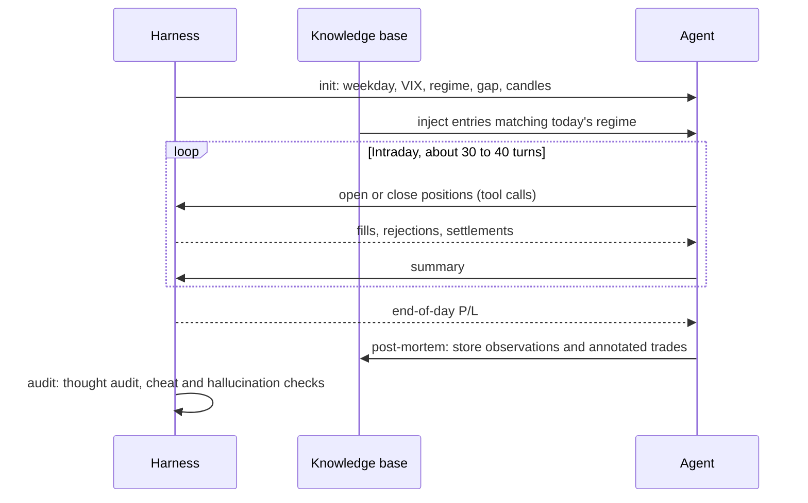


**Guardrails.** The harness supports a daily loss circuit breaker (its threshold is logged as $0 in every run analysed here, so I do not treat it as active), per-side exposure caps, position-delta validation, an end-of-session audit (thought auditing and cheat detection), and hallucination checks on the agent's claims about its own positions. 21% of the agent's open requests were not accepted by the harness.

**Prompt.** A versioned system prompt (`v4_guidelines`, which turned earlier hard rules into guidelines) for all runs analysed here except July (`v2_exploration`).

**Runs analysed (from logs).**

| Run | Lane | Sessions | Notes |
|---|---|---:|---|
| Jan to May 2025, chained | fresh memory | 102 | KB empty at start, carried month to month |
| April 2025 replay | replicate | 21 | Same configuration as April fresh |
| April 2025 replicate 1 | replicate | 9 | Same configuration; stopped after 9 sessions |
| January 2025 replicate 1 | replicate | 11 | Same configuration; stopped after 11 sessions |
| July, August 2025 | continued | 43 | Later months, large accumulated KB |

The September 2025 log in the local archive is empty and is excluded.

**Figure C. Experimental design.** Every April run starts from the same 219-entry KB written by January to March; the January replicate starts empty like the main chain.

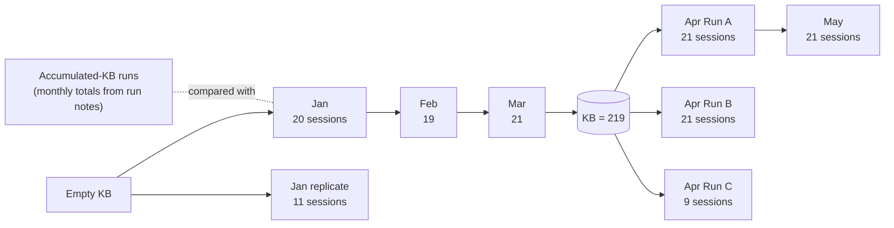


## 3. Method

- **Parsing.** [`analysis/parse_logs.py`](analysis/parse_logs.py) turns the raw run logs into one row per session ([`data/sessions.csv`](data/sessions.csv)). Raw logs are not published because they contain strategy detail; session-level aggregates are.
- **Session P/L** is the change in the harness's own running total between consecutive sessions. This matters: a session cut short by the circuit breaker, or with late settlements, under-reports P/L in its last in-session summary. With this method, monthly totals match the run notes exactly for January to April; May differs (see Limitations).
- **Identical configuration is verified, not assumed.** All replicates share the model (GLM-5), the system-prompt hash (`40a87a77a088`) and the starting KB (219 entries for every April run, 0 for both January runs), read from the log headers.
- **Uncertainty.** Monthly totals carry 95% bootstrap intervals from resampling sessions (10,000 resamples). Correlations carry bootstrap intervals. Replicate comparisons pair the same trading day across runs.
- Everything is reproducible from `data/sessions.csv` with [`analysis/analyze.py`](analysis/analyze.py), which writes [`data/stats.json`](data/stats.json) and the figures.

## 4. Results

### 4.1 Identical configurations, opposite outcomes

April 2025 was run twice in full with the same model, prompt, starting memory and data. Run A lost $10,800; Run B gained $9,736. A third run (stopped after 9 sessions) was at −$22,159.

| Pair (matched trading days) | Days | Daily P/L correlation | Mean absolute daily difference |
|---|---:|---:|---:|
| April A vs April B | 21 | 0.76 | $1,489 |
| April A vs April C | 9 | 0.25 | $2,693 |
| April B vs April C | 9 | 0.53 | $2,815 |
| January fresh vs January replicate | 11 | 0.85 | $717 |

Daily results are correlated because the market dominates any single day. The divergence comes from a few days: **the three largest gaps between Run A and Run B were all gap-down sessions at elevated volatility (VIX 60, 41 and 30), and together account for 41% of the total absolute divergence.** On the VIX 60 day the two runs returned −$3,449 and +$3,226. In calm January the replicate correlation is higher (0.85) and the daily differences are half as large.

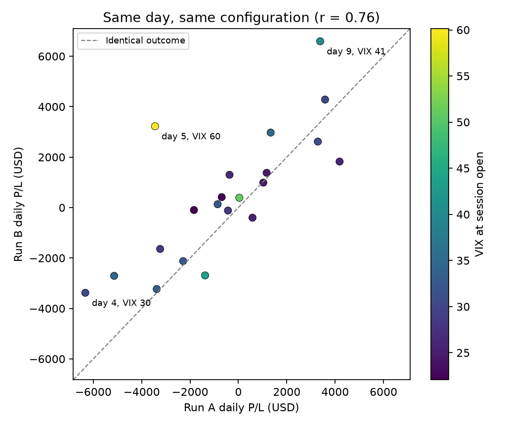

*Figure 4. Each point is one April trading day; the dashed line is where identical runs would agree. Most days sit near it; the outliers are the stressed gap-down days.*

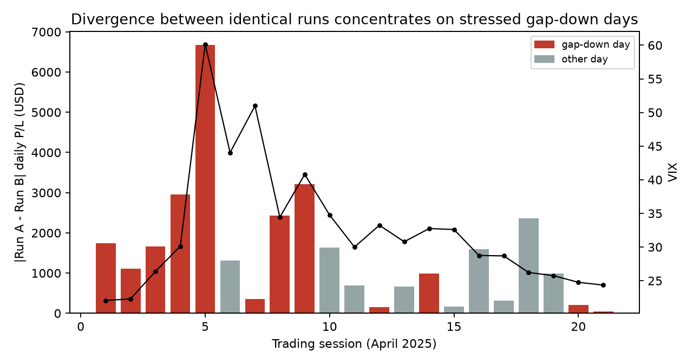

*Figure 5. Absolute daily difference between Run A and Run B, with VIX. High volatility alone did not split the runs: the VIX 44 and 51 sessions that were not gap-downs (days 6 and 7) stayed close. The divergence came from the combination of a gap down and a volatility spike.*

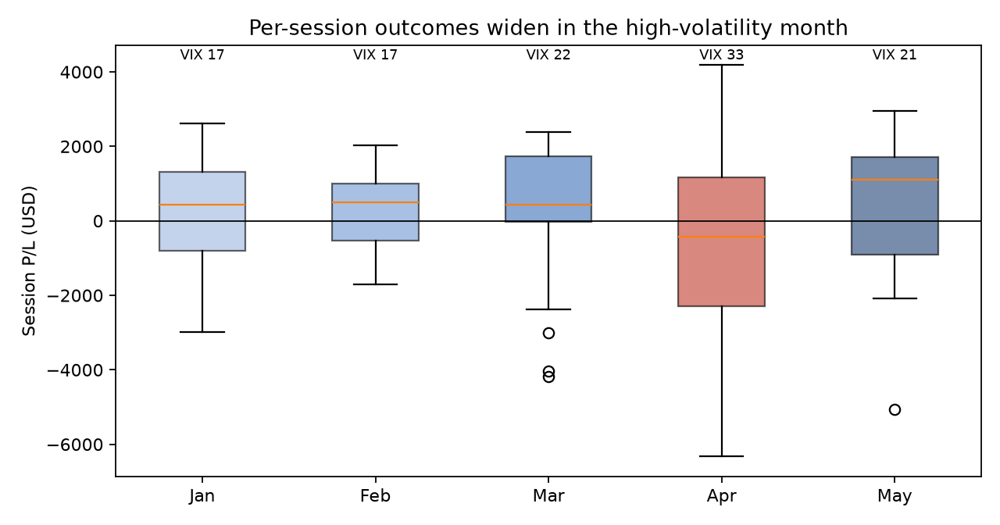

*Figure 6. Per-session P/L by month in the fresh-memory chain. The standard deviation of session outcomes in April ($2,862) is about twice that of January and February ($1,442 and $1,157).*

*Interpretation.* Sampling noise is not uniform: it is amplified in the most unusual conditions. Sources include temperature-0.7 sampling, tool-call non-determinism and path dependence, since each run writes different memories during the month that later sessions read.

### 4.2 Behaviour shifts with the volatility regime

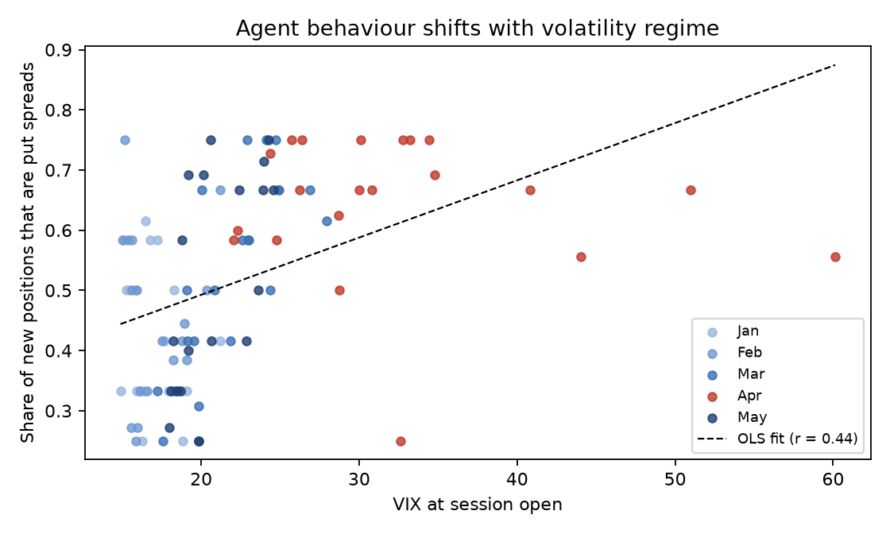

*Figure 2. Put share of new positions per session against VIX at session open, fresh-memory chain, coloured by month.*

Across the 101 fresh-memory sessions with at least one position, the share of new positions on the put side rises with VIX at session open (Pearson r = 0.44, 95% CI 0.30 to 0.60; about +1 percentage point per VIX point). On **gap-down days** specifically, the put share rose month by month: 37% (Jan), 49% (Feb), 58% (Mar), **68% (Apr)**, 58% (May). Selling put spreads after a gap down in a volatility spike is the side that loses most if the move continues, which is what happened in April. Above VIX 40 the share levels off at roughly 0.55 to 0.67, so the linear fit overstates the extreme tail.

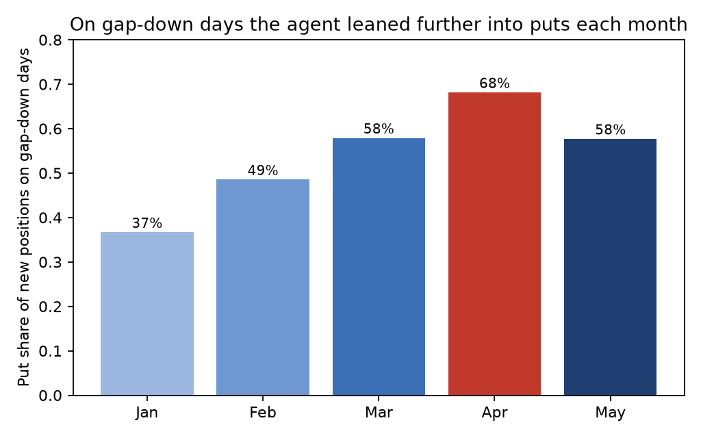

*Figure 7. Put share of new positions on gap-down days, by month. The rise runs alongside the growth of the knowledge base (Figure 8).*

*Interpretation.* The agent's mix of actions drifts with regime and with the memory it has accumulated. My working hypothesis, from reading sessions, is that the KB filled with moderate-volatility gap-down patterns that "worked" and were then applied out of distribution in April. This analysis shows the association, not the cause; Section 6 proposes the ablation that would test it.

### 4.3 Fresh vs accumulated memory: suggestive, not established

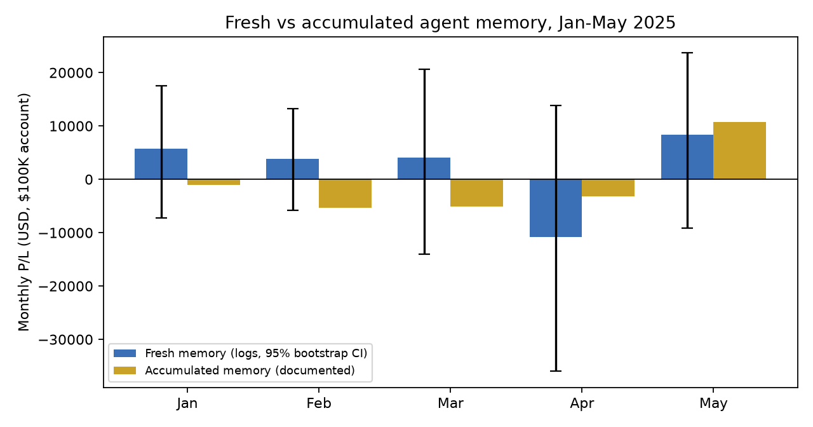

*Figure 1. Monthly totals, fresh memory (with session-bootstrap 95% intervals) vs accumulated memory (run notes).*

| Month (2025) | Fresh memory (logs) | 95% bootstrap CI | Accumulated memory (run notes) |
|---|---:|---|---:|
| January | +$5,773 | −$7,225 to +$17,559 | −$1,038 |
| February | +$3,804 | −$5,791 to +$13,198 | −$5,293 |
| March | +$4,045 | −$14,015 to +$20,602 | −$5,108 |
| April | −$10,800 | −$35,996 to +$13,827 | −$3,235 |
| May | +$8,337 | −$9,203 to +$23,695 | +$10,747 |
| **Total** | **+$11,159** | | **−$3,927** |

Fresh memory did better in January to March and worse in April and May. But **every monthly interval contains zero**, and Section 4.1 shows single runs can differ by $20K. The fresh-memory runs also included harness fixes and the v4 prompt, which the accumulated-memory runs did not have in full. The honest conclusion is that memory state *may* matter a lot, and that this design cannot separate it from noise and from the other changes.

### 4.4 Memory growth and effort

The KB grew roughly linearly (73, 141, 219, 301, 375 entries at the end of each month), while cumulative returns did not trend with it.

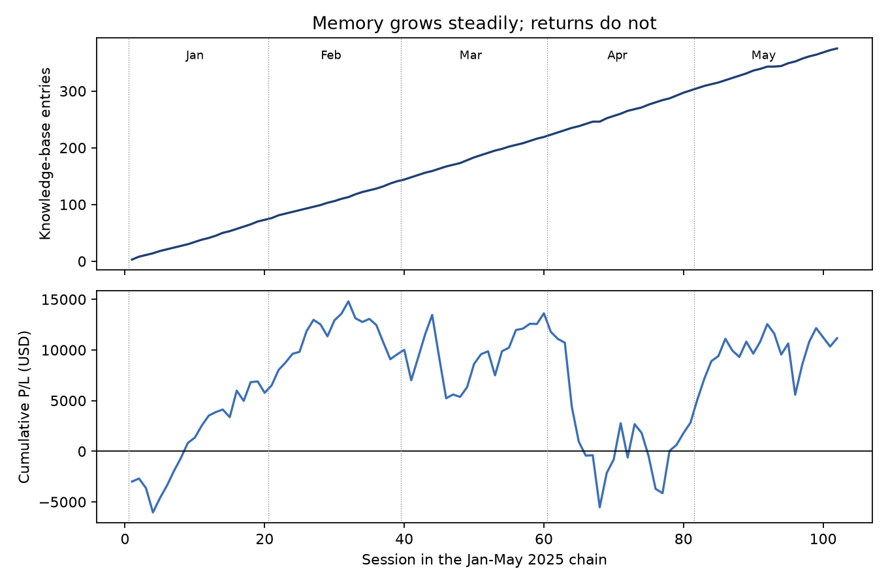

*Figure 8. Knowledge-base size and cumulative P/L across the 102-session chain. More memory did not translate into steadily better results; the April drawdown arrived with the largest KB the agent had yet had.*

Median turns per session rose in April (37, vs 31 to 34 in calmer months, 39.5 in replicate C). Across all 181 completed sessions, turns correlate with VIX (r = 0.29), consistent with the agent working harder in unfamiliar conditions.

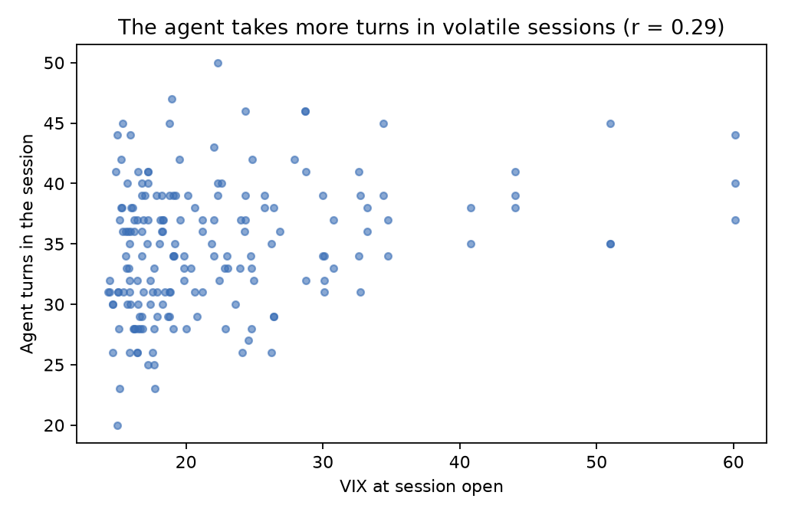

*Figure 9. Agent turns per session against VIX at session open, all runs.*

## 5. Implications for evaluating agents

1. **Run every configuration several times and report spread, not a point estimate.** One April run would have supported "the agent loses money in a crisis"; another, "the agent profits from a crisis".
2. **Expect noise to be regime-dependent.** Calm-period replicates agreed closely; stress-period replicates did not. Evaluation suites dominated by typical cases will understate variance where it matters.
3. **Treat persistent memory as an experimental variable.** Memory is a second, slowly moving policy that can entrench patterns from one regime. It needs ablations like any other component.
4. **Guardrails constrain actions, not judgement.** Exposure caps and validation limited what the agent could do in a session; nothing in the harness detected the regime-dependent drift in what it chose to do. Drift needs to be monitored as a metric in its own right.

## 6. Limitations and next experiments

**Limitations.** One model family (GLM-5) with one temperature; few full replicates (two complete April runs, two partial); accumulated-memory figures come from run notes because their logs are not in this archive; the fresh vs accumulated comparison is confounded by harness and prompt changes; May's log-derived total (+$8,337) differs from the run notes (+$9,246), plausibly because of one incomplete session; P/L comes from the simulator's fill model, not live execution; and one market and instrument.

**Next experiments.**
- **Memory ablation on April:** replay April with an empty KB and with the March-end KB, several seeds each, to test whether accumulated memory causes the put-side drift.
- **Seeds × regimes:** 5+ replicates per month across calm and stressed months to estimate variance as a function of regime.
- **Temperature and model sweep:** the same protocol at temperature 0 and across model families (local Qwen runs by a collaborator reproduced GLM-class results on January to March).
- **Memory hygiene interventions:** regime-gated retrieval, decay, or out-of-distribution warnings when current conditions fall outside the KB's experience, measured against the drift in 4.2.

## Reproducibility

```bash
uv sync
uv run analysis/analyze.py          # regenerates data/stats.json and figures/ from data/sessions.csv
uv run analysis/parse_logs.py <raw_log_dir>   # only with access to the raw logs
```

## Credits

- **Simulation engine:** a private third-party options replay engine, used with access from its maintainers. RetroAgent is built on top of it; the engine itself is not part of this work.
- **Agent layer (RetroAgent):** original plan, thought-auditing and cheat-detection design, and system-prompt versioning by **Alireza Haghdoost**, who also reviewed the implementation.
- **Implementation and research:** about 80% of the agent-layer commits, all experiment runs, the gap analysis and this paper by **Elias Chawki**.
- **Replication:** local Qwen runs by a collaborator.

*Simulated trading on historical data. Nothing here is investment advice.*

License: MIT
